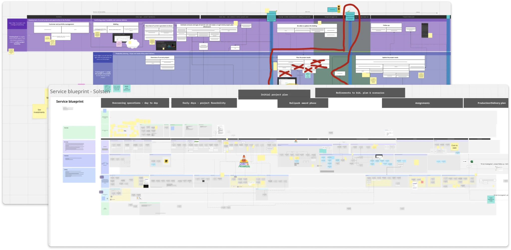
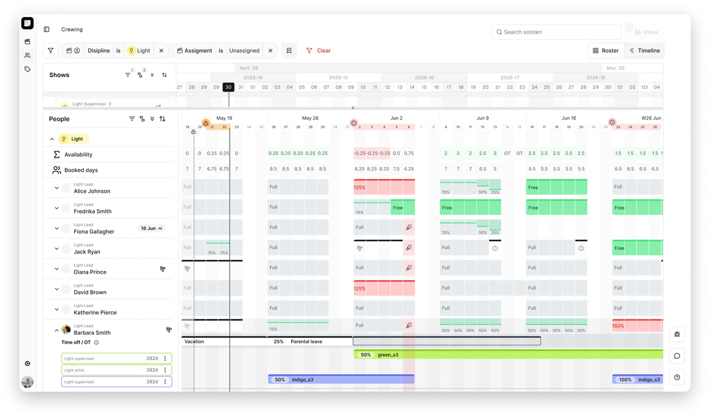
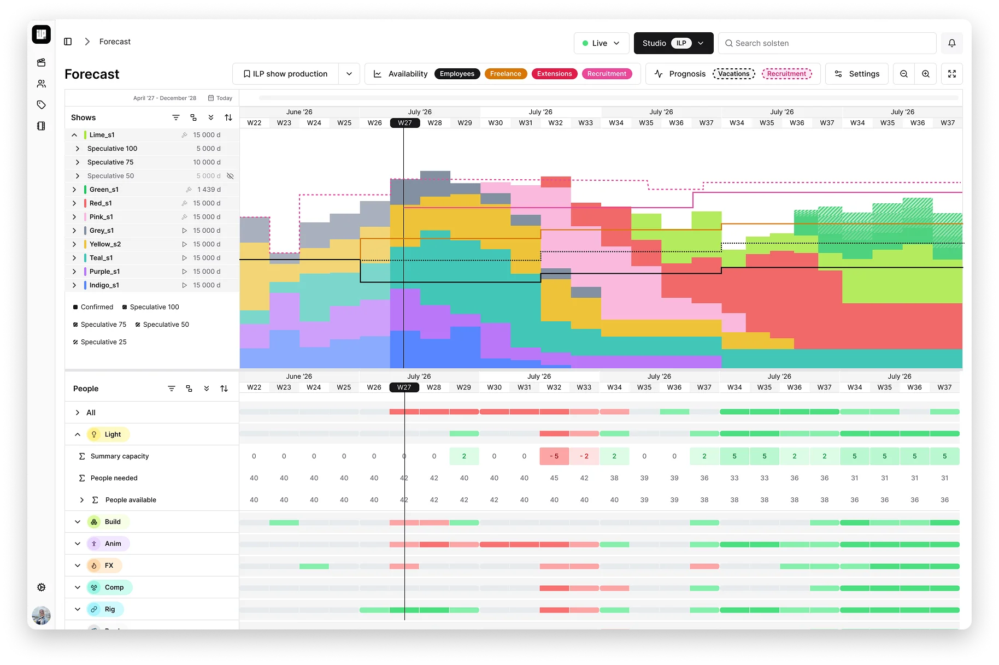
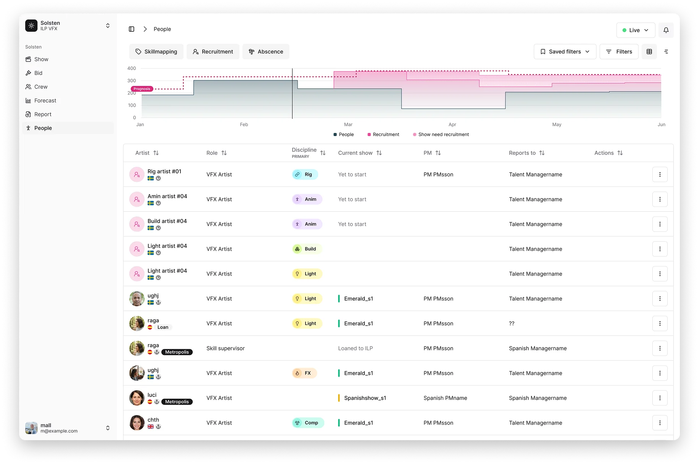
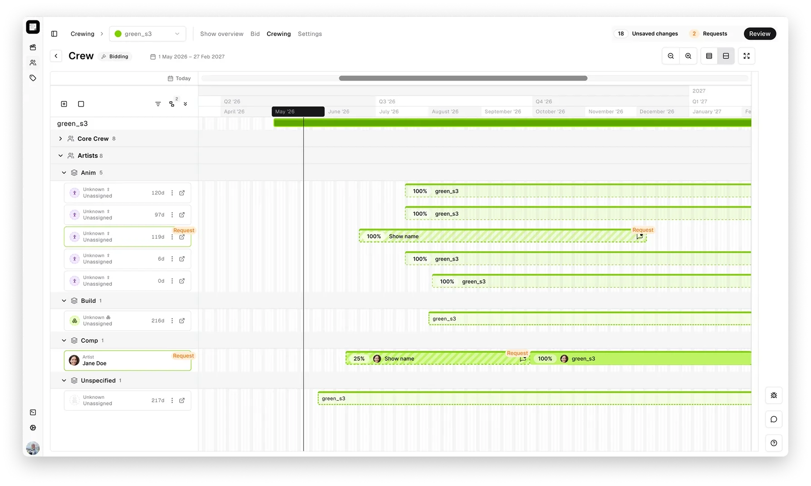
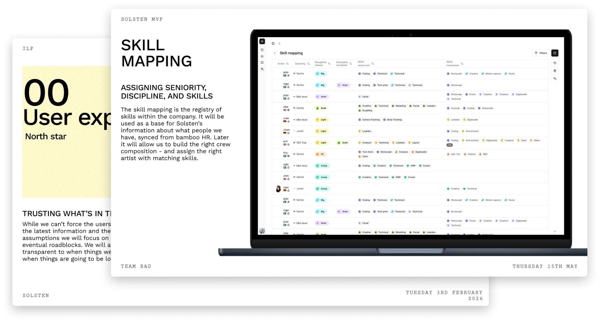

---
# Built only from the slides ILP approved in writing (ILP case.pptx, October 2026).
# Don't add anything about ILP beyond what those slides show.
title: Planning platform for VFX
client: ILP VFX
order: 0
accent: ilp
summary: Planning platform for VFX, from research to live product.
description: How Malin Lilja designed a planning platform that brings crewing and bidding together at ILP VFX, replacing a legacy system and disconnected spreadsheets.
tags: [Product design, UX design]
# Badges on the home page card: your role on the project
roles: [Senior UX designer, Design lead]
# Big tile in the summary bento: why the project existed (from the slides)
purpose: "Bring crewing and bidding into one planning platform, replacing a legacy system and disconnected spreadsheets."
hero: ./all-crews.webp
cardBackground: ./card-background.webp
# Card pictures: the approved All crews view, plus a crew detail view and the ILP banner
# (both approved by ILP in writing, October 2026)
cardImages:
  - ./all-crews.webp
  - ./crew-detail.webp
  - ./ilp-banner.webp
logo: ./logo.png
heroAlt: A dark timeline view of all crews, with shows as coloured bars from April 2026 to February 2027, FX supervisor slots under each show, and a list of people below. Names are masked.
tldr:
  company: ILP VFX, one of Scandinavia's largest VFX and animation studios (200+ people)
  role: Senior UX Designer
  timeline: 2025–present
  team: A product manager and 3–4 developers
  # Stakeholders tile in the summary bento (from the slides)
  stakeholders: [Executive producers, Crewing managers, Talent managers, Producers]
  # problem, whatIDid and result: drafts by Claude from the slides, rewrite freely
  problem: Bidding and crewing lived in a legacy system and separate spreadsheets, so no one could see what had changed or which scenarios were possible.
  whatIDid: Collected the user research in a living service blueprint, designed the modules with the product manager and developers, and built a design system based on shadcn.
  result: Delivered a people and skills module, a bid import module, and drafting and assignment of key artists, replacing the manually updated spreadsheets.
links: []
---

## The problem

A VFX studio sells its work through bids, then staffs each show with artists over months to deliver it. Simply put, if you make the right bid and deliver on it, you're profitable. At ILP, these steps lived in a legacy system that had become one solution for everything: time off, who was on each show, decisions on key personnel, finances, and even the assignment of workstations.

Executive producers, crewing managers, talent managers and producers each kept their own picture of the plan. They needed one source of truth. But without workarounds and several separate sheets, it was impossible to trace what had happened, what had changed, and which scenarios were possible. It relied on specific people knowing how to handle it. If one specific person took unplanned leave for longer than a few weeks, salaries couldn't be paid out correctly.

Replacing it all in one go was impossible, as it held all the information. The crewing manager spent days of their time correcting this information. Although the system had worked when the studio was 10 people, over time it grew to 200+ people, plus sister studios and subsidiaries which led to a need for an updated system that could manage a larger company.

The goal was to design a tool that people would actually use to connect the dots when planning and would keep everyone on the same page. One guide and source of truth when asking "What's going on?"

## Research

I collected the user research in a living "service blueprint" to help product management and the team understand the relationships and which priorities to set.

## Process
We started out an iterative process, chucking the big system into pieces we could ship and collaboratively validate with the users. I shared concepts with the team through live, and asyncronous, design feedback sessions, setting alignmet on what to build and why. Getting backend, frontend and product management to align on a scope and design. 

## Result

I had a strong impact on how the product took shape. Together with a team of 3–4 developers, we:

- Delivered the people and skills module and removed the manually updated spreadsheets, so crewing could access this information within the tool
- Delivered the bid import module. The bidding process itself wasn't the problem; keeping everyone else in sync was
- Made it possible for crewing to draft key artists on a daily, weekly and monthly basis, and to group and filter them flexibly to get a good overview of the plan and its options
- Made it possible to assign these slots to people synced from the HR system, in a few clicks

 

 

…and a lot of supporting deliverables, such as:

- Set up the user feedback and acceptance process with my product manager
- Helped my product manager with design and system requirements for each module
- Built a design system based on shadcn for easier theming and consistency
- Presentations, research initiatives and workflow charts
- Lots of UI handovers, flows and direction
- Recorded design walkthroughs with the team, so they could give feedback asynchronously

