---
# Built from the slides ILP approved in writing (ILP case.pptx, October 2026) and Malin's
# ILP story (her Eversports call prep, November 2026), which she confirmed is approved.
title: Planning platform for VFX
client: ILP VFX
order: 0
accent: ilp
summary: Planning platform for VFX, from research to live product.
description: How Malin Lilja designed a planning platform that brings crewing and bidding together at ILP VFX, replacing a legacy system and disconnected spreadsheets.
tags: [Product design, UX design]
# Badges on the home page card: your role on the project
roles: [Senior UX designer, Design lead]
# Big tile in the summary bento: why the project existed (from the slides)
purpose: "Bring crewing and bidding into one planning platform, replacing a legacy system and disconnected spreadsheets."
hero: ./all-crews.webp
cardBackground: ./card-background.webp
# Card pictures: the approved All crews view, plus a crew detail view and the ILP banner
# (both approved by ILP in writing, October 2026)
cardImages:
  - ./all-crews.webp
  - ./crew-detail.webp
  - ./ilp-banner.webp
logo: ./logo.png
heroAlt: A dark timeline view of all crews, with shows as coloured bars from April 2026 to February 2027, FX supervisor slots under each show, and a list of people below. Names are masked.
tldr:
  company: ILP VFX, one of Scandinavia's largest VFX and animation studios (200+ people)
  role: Senior UX Designer
  timeline: 2025–present
  team: A product manager and 3–4 developers
  # Stakeholders tile in the summary bento (from the slides)
  stakeholders: [Executive producers, Crewing managers, Talent managers, Producers]
  # problem, whatIDid and result: drafts by Claude from the slides, rewrite freely
  # DRAFTS by Claude from the case text (brief, insight, designIntent): rewrite freely
  brief: "A new planning platform for a 200+ person VFX studio, taken from the first research to a live product."
  # DRAFT by Claude from "The problem" section below: rewrite freely
  problem: "The studio's legacy system had become the answer to everything, from time off and who was on each show to finances. As the studio grew, each role kept its own picture of the plan, no one could trace what had changed or which scenarios were possible, and it all relied on a few people knowing how to handle it."
  # Malin's insight, tightened by Claude: rewrite freely
  insight: "Years of processes and workarounds had to keep working in the new system, and a visual planning tool sets a high bar for interaction, with many opinions to weigh and prioritize. With the scope shifting often, it was hard to know what level of quality to design for and which users had the highest priority."
  # Malin's design intent, tightened by Claude: rewrite freely
  designIntent: "Break the big system into modules we could ship and validate with users one at a time: people and skills, bid import, then drafting and assigning key artists, building towards the studio's full planning. A living service blueprint and a shadcn-based design system kept the team aligned and let us focus on flows rather than component details."
  whatIDid: Collected the user research in a living service blueprint, designed the modules with the product manager and developers, and built a design system based on shadcn.
  result: "The skill-mapping spreadsheet is retired, and crewing is piloted with the crewing team and production management, with less manual input and friction."
links: []
---

<!-- DRAFT by Claude, following Malin's ILP story (Context, six steps, Outcome). Rewrite freely.
     Gaps in [brackets] are hidden until Malin fills them in. -->

## Context

A VFX studio sells its work through bids, then staffs each show with artists for months to deliver it. Profit comes down to two things: not going over the hours you bid, and keeping everyone booked.

At ILP, a studio of 200+ people, planning lived in a legacy system that had become the answer to everything, from time off and who was on each show to finances, plus several spreadsheets that didn't talk to each other. A handful of people had become caretakers just to make the numbers add up. If one of them was away for more than a few weeks, salaries couldn't be paid out correctly. Management couldn't easily see what was profitable, what could run at the same time, or who was available, and crewing managers, talent managers and producers each kept their own picture of the plan.

The team was new, the product was new, and there was no backlog. Everything was connected, but we couldn't build it all at once. So where do we start?

## Understand the whole

I interviewed users and stakeholders about their pain points, what worked and shouldn't change, and what they hoped for. Then I mapped how it all connects, from forecast to bid to staffing to reporting, in a living [service blueprint](https://www.nngroup.com/articles/service-blueprints-definition/) that helped product management and the team set priorities.

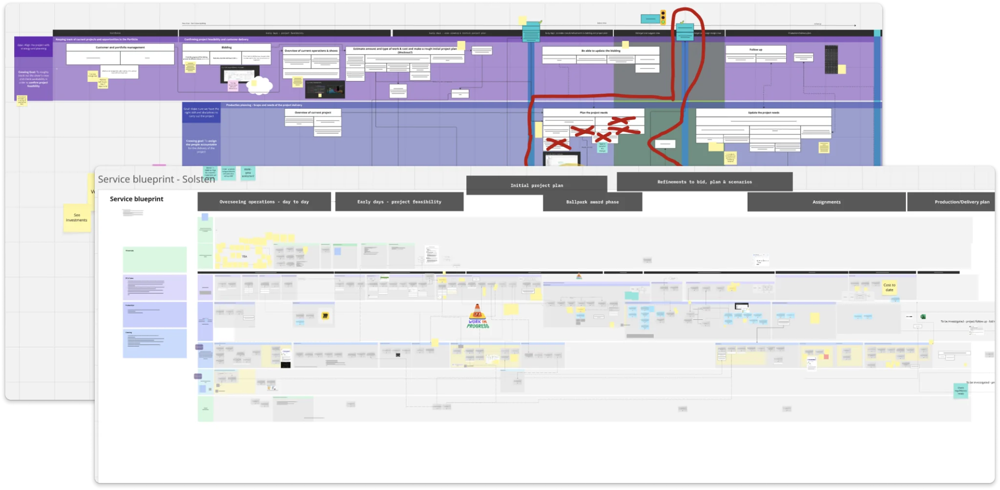

## Pick a starting point

I looked for a need that would cut double entry, could be used right away and would give us feedback fast. Skill mapping ticked all three: talent managers kept it in a spreadsheet, and the rest of the planning depended on it. I pitched it to our product manager, and we refined the scope together into an MVP.

[What you chose not to start with, and why.]

## Set the goal

Inspired by Google's HEART framework, we made adoption the first goal: the tool had to replace the current process. So we started with skill mapping. It replaced a spreadsheet and gave access to each artist's name, role and contract length without double entry. The signal was talent managers using the tool instead of Google Sheets, and we tracked how use spread among them.

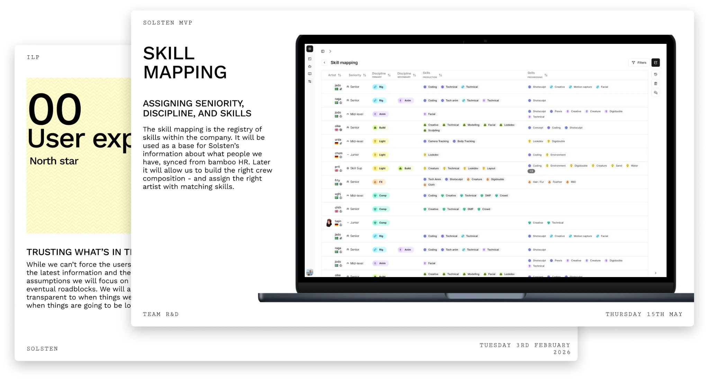 ![The HEART goals as a table, for skill mapping and crewing. Adoption, the first goal, is highlighted: talent managers use the tool instead of Google Sheets; for crewing, they choose the tool over Miro for planning key skills. Retention for skill mapping: use spreads among them, and the quarterly assessment moves over to the tool; for crewing, they keep using it after the pilot. Crewing also has happiness: the tone in our regular feedback sessions; and task success: fewer clicks and manual inputs, and less time to prepare the plan. Engagement has no goal.](./heart-goals.svg "The HEART goals, with adoption first")

## Build on it

<!-- DRAFT by Claude: rewrite freely. Malin's original crewing sketch can go after the pen-and-paper paragraph when found. -->
With skill mapping in place, we could take on crewing, where the stakes were higher: crewing managers decide who works on which show, and for how long.

I started where I usually do, with pen and paper: how to read a show's crew at a glance, and how to fill an empty slot with the right person.

Then I turned the sketch into concept prototypes in Figma and tested them with crewing managers, to check the flow and what they needed to know when choosing an artist. We shipped a first version as a pilot and kept refining it in our regular feedback sessions. Crewing users were more critical than talent managers, so we widened the HEART goals to retention, happiness and task success as well (see the table above).

<figure class="figure">
  <video src="/work/ilp/crewing-pilot.mp4" poster="/work/ilp/crewing-pilot.jpg" controls muted playsinline preload="metadata" aria-label="Screen recording of crewing in the pilot: a timeline of shows with their crew slots, a slot opened to see its assignment and matching artists, then filtering by discipline and grouping people. Names are blurred."></video>
  <figcaption>Crewing in the pilot. Names are blurred.</figcaption>
</figure>

## Learn in production

We worked in two-week cycles, close to the developers, and I recorded design walkthroughs so the team could also give feedback asynchronously. [Umami](https://umami.is/) showed *what* users did, and usability tests explained *why*. I turned both into the next sprint's priorities.

For example, tests showed users look at about 20 artists at a time, so we adapted the components to switch between a compact mode for work and a roomier one for presenting.

## Designing ahead

I made concept prototypes in Figma and tested them with users, to work out what information needed to sync and how they wanted to use the tool. [One thing you found in concept testing.]

I often start with pen and paper, to work out what a view needs to do before I open Figma. This sketch explores how a reviewer sees new requests, what's live, and publishes only the changes that need review.

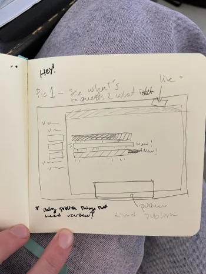

Alongside what we shipped, I designed and conceptualized the modules further ahead on the roadmap: crewing, the forecast, the people list, a show's crew, all shows and the bid summary.

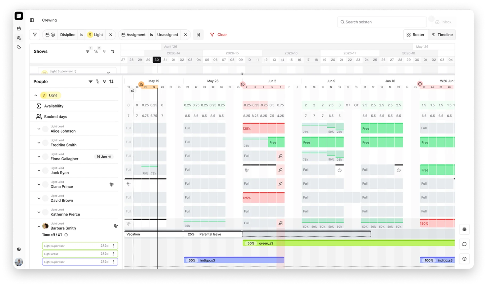 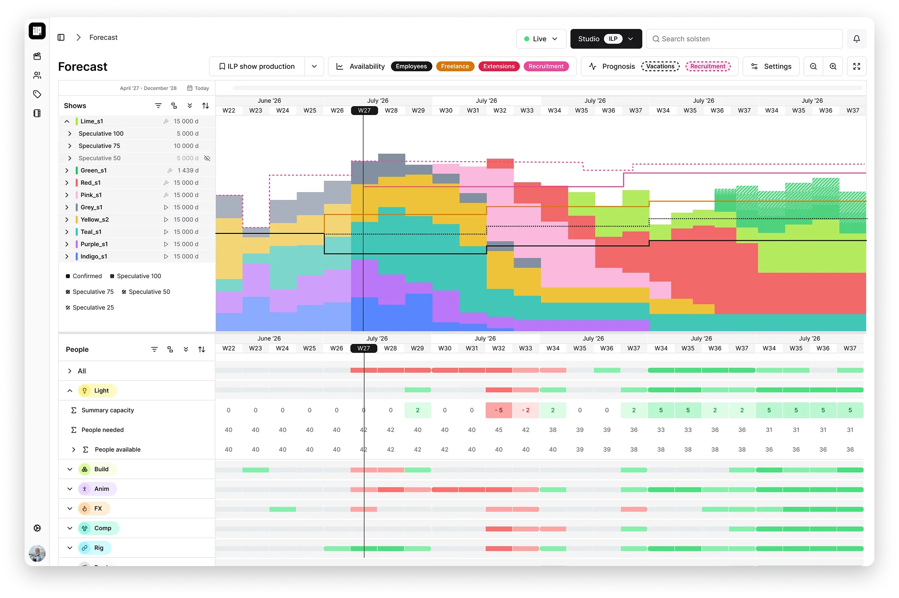 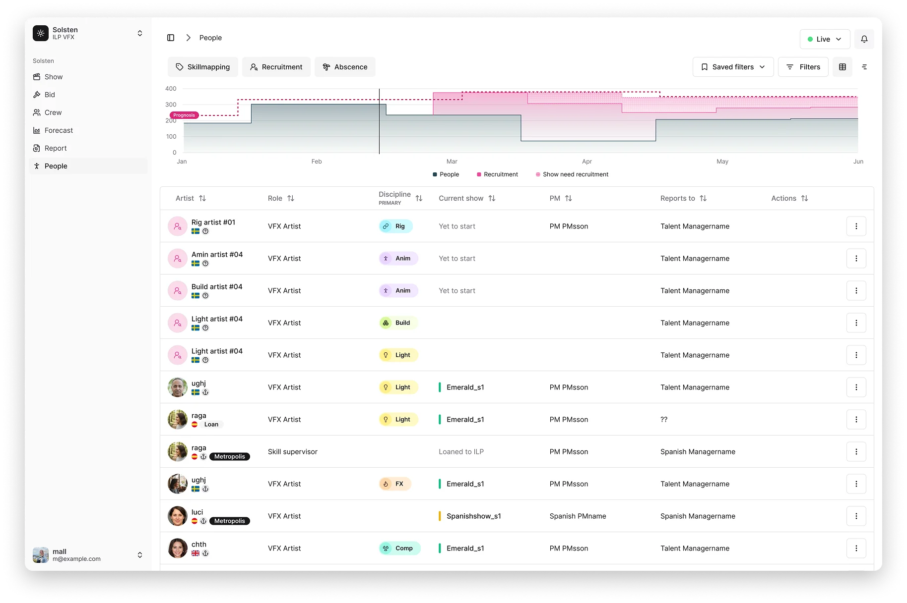 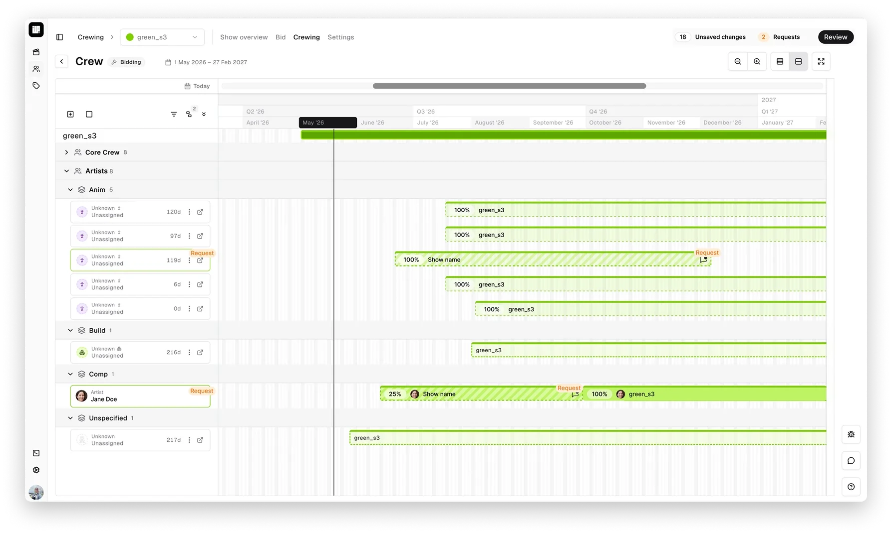 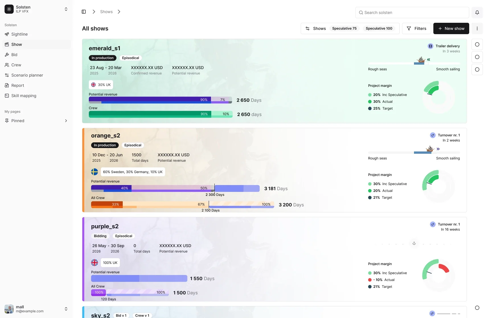 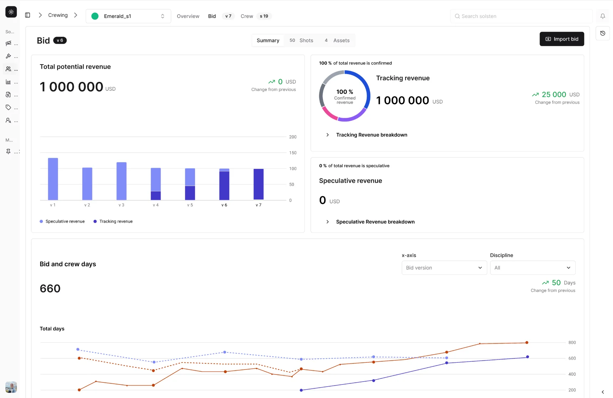

## Outcome

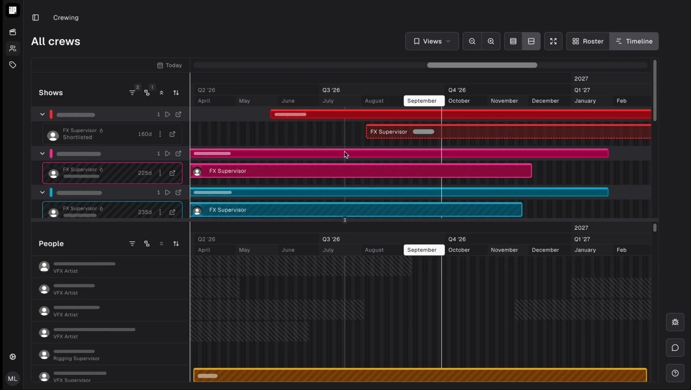 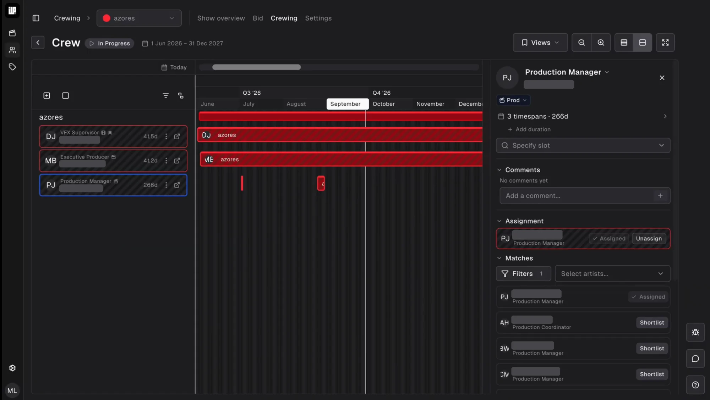

*Unfortunately, I can’t show more of the live product, as its screens hold real financial, personal and planning data.*

The skill-mapping spreadsheet is retired. Crewing is piloted with the crewing team and production management, with less manual input and friction: users save their own filters and views and plan key skills in the tool, and we can import a bid, see how it has changed and compare it with the crew plan. [Add a number from the HEART goals.] With that foundation and a design system, the platform is built so it can roll out to other studios in the group.

Along the way, I also:

- Set up the user feedback and acceptance process with my product manager
- Helped my product manager with design and system requirements for each module
- Built a design system based on shadcn for easier theming and consistency, including the product's light and dark mode
- Made presentations, research initiatives and workflow charts
- Did lots of UI handovers, flows and direction

> Start small where the value is biggest, and let the users show the way.
