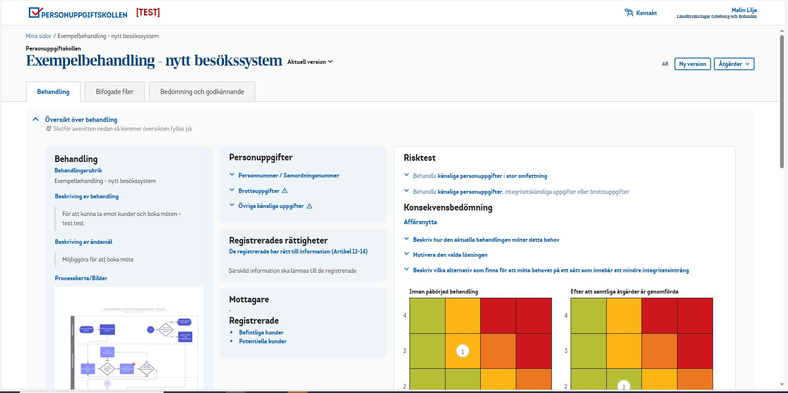
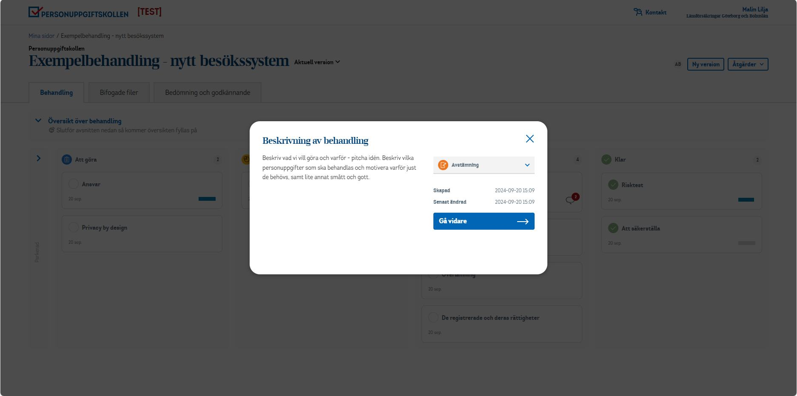

## Our role as an innovation partner

Our small team at Amply worked as Länsförsäkringar's innovation partner. We built tailored services that made internal processes faster and more consistent.

My role shifted with each service. Sometimes I was involved from the very first idea, and sometimes I took over an existing service to maintain and develop it further.

## How I worked

- **Research:** gathered stakeholder and user needs, and mapped user journeys
- **Design:** process design, low- and high-fidelity wireframes and UI, within Länsförsäkringar's brand guidelines
- **Delivery:** detailed handovers for developers, and iterations with users as the services grew
- **Project management:** prioritised and broke down features, reported to stakeholders and drove user adoption

## Spotlight: Personuppgiftskollen

Insurers handle large amounts of personal data, and GDPR requires them to document how. Personuppgiftskollen ("the personal data check") is a tool that makes this compliance work and documentation easier.

Here I was both product owner and UX/UI designer. For each new feature, I ran an iterative process with users and developers to find out what was needed and what was technically feasible.

 

## Outcome

- 5 internal services designed and developed further over 2 years
- A GDPR tool that made compliance documentation easier for staff
- [Add a quote from a stakeholder, or a measurable result]

## Reflection

[2–3 sentences: for example, what combining design and project management taught you about working in a regulated industry.]
