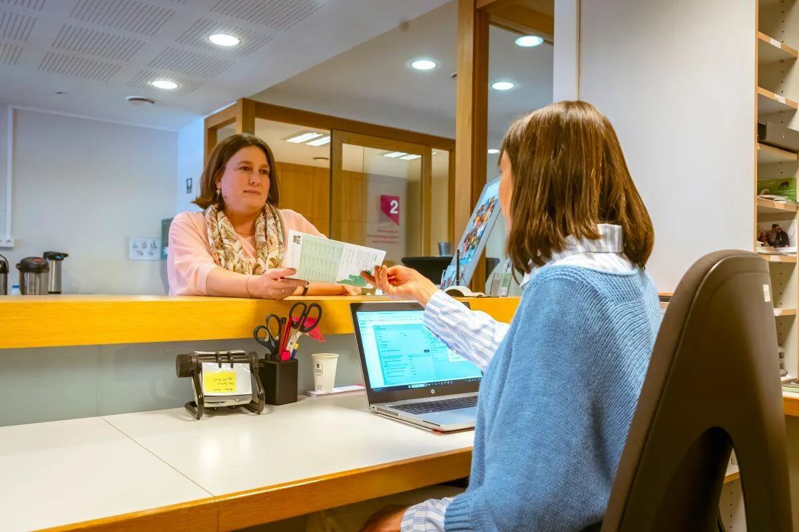

## Two very different users

The platform had two sides. Customers booked appointments in a white-label interface that each client could brand as their own. Staff used a separate set of tools to book, manage and plan appointments, with extensive configuration behind it.

I designed both sides. That meant balancing a simple, accessible booking flow for the public with powerful configuration for administrators.

## Research with real clients

I worked directly with the Product Owner and product team, and ran user research with clients such as the Public Service of Wallonia in Belgium. [Add one insight that changed the design.]

## A design system for a white-label product

Because every client brands the interface, the components had to be flexible and still meet WCAG accessibility requirements. I owned the design system backlog and ran the design system forum, where designers and developers agreed on what to build next.

## Leading the team with Lean UX

From 2022, I was also Agile Team Lead for the development team. I introduced Lean UX: testing assumptions early and keeping design and development in the same loop. [Add what changed, e.g. earlier user testing or less rework.]

## Outcome

- [Launch, customers or markets using the platform]
- A shared design system that kept a white-label product consistent and accessible
- A development team working in shorter design and feedback loops

## Reflection

[2–3 sentences: for example, what leading developers taught you as a designer.]
