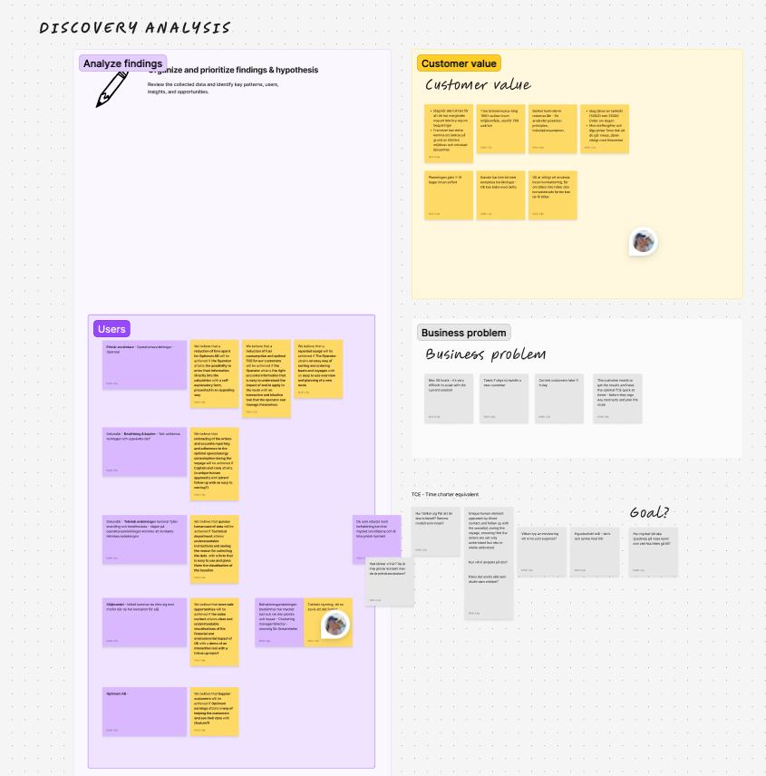
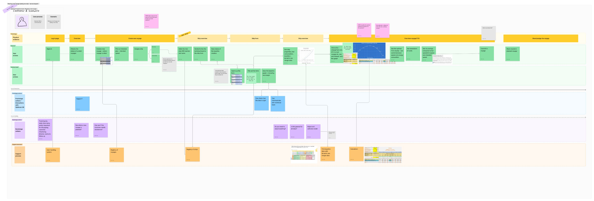
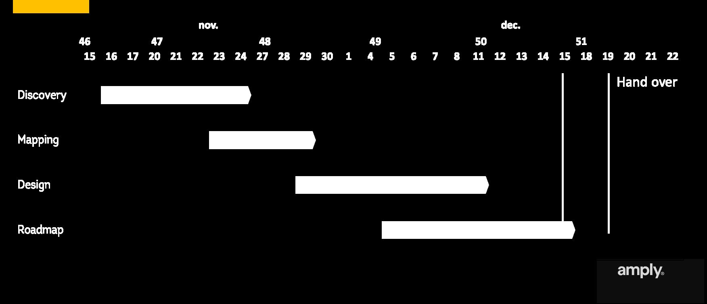
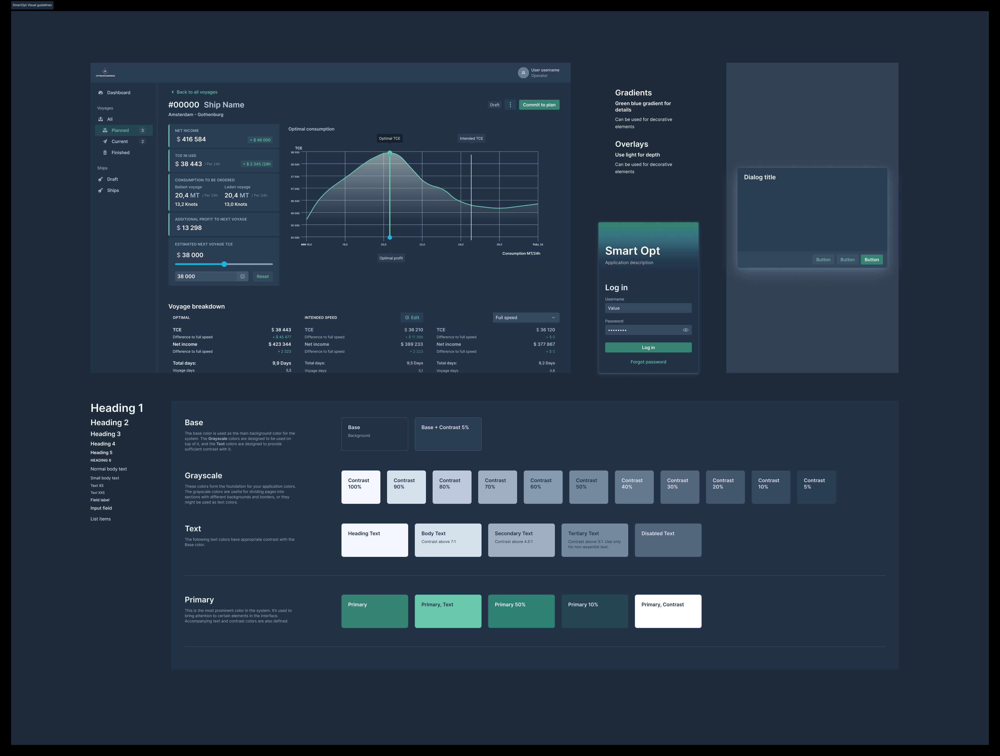

## The problem

A voyage's earnings depend on many things at once: the ship, the route, the market, the next voyage and days in port. Weighing all of them is hard, so speed and fuel orders are often far from the most profitable option.

Optimum Earnings had a calculation method that could find the optimum. The question was whether it could become an app that shipping teams would actually use.

## Phase 1: Pre-study

The goal was to test whether the calculation method could work as an app.

- **Research:** I interviewed expert users and analysed competitors.
- **Mapping:** I made a service blueprint showing the user journey next to the system functionality behind it.
- **Concept:** I created an early concept and evaluated it with the developers for feasibility.

The pre-study gave the client a service concept and specifications, which they used to scope and estimate the build.

## Phase 2: Design and delivery

- **Roadmap:** As product owner, I owned the roadmap and broke the app into epics and stories for the team.
- **UI design:** I set up the baseline design system and designed the main user flows, iterating on the concept.
- **Delivery:** I kept stakeholders informed and on track until the app launched to customers.

## Outcome

- Went from an expert calculation method to a launched product
- A design system and main flows that the team could build on
- [Add a key design decision, e.g. how you made complex calculations understandable]

## Reflection

[2–3 sentences: for example, what being both product owner and designer taught you about trade-offs.]
