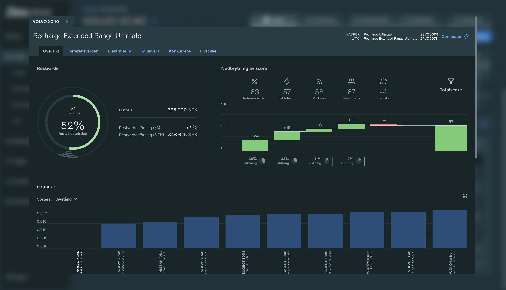
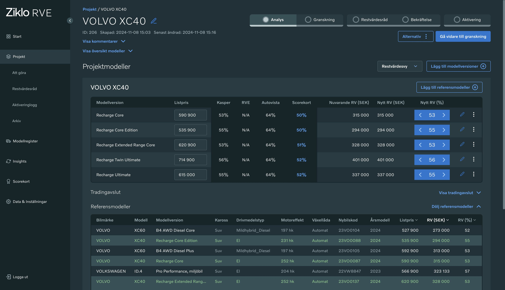

## The problem

A car's residual value is what it's expected to be worth at the end of a lease. Getting it right matters for a financing bank.

Ziklo RVE is a tool that helps with keeping correct and updated residual values for Ziklo. This tool analyzes and determines existing residual values while also suggesting new residual values by giving an automatic score to the cars analyzed.

## Designing for the real process

When I joined the project there was already an application in place that had yet to face user adoption. My role in the project was to research and develop the users' process and adapt the current application to it, given the constraints that were already in place. I mapped out the user journey, iterated it with the intended users and designed the specifications to hand over for implementation.

The result follows the team's own workflow. The project board moves each car model through three stages: residual value analysis, the residual value council and decision, and activation.

## Supporting adoption

During the adoption phase of the project I assisted with testing and user guidance, acting as an advocate for the users.

## Outcome

- A tool restructured around the team's actual valuation process
- A visual representation of the scorecard, making sense of the model behind it
- Ziklo is now taking the application in-house, the users are embracing it!

## Reflection

[2–3 sentences: for example, what improving an existing product taught you, compared with designing from scratch.]
